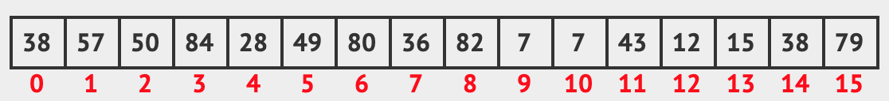
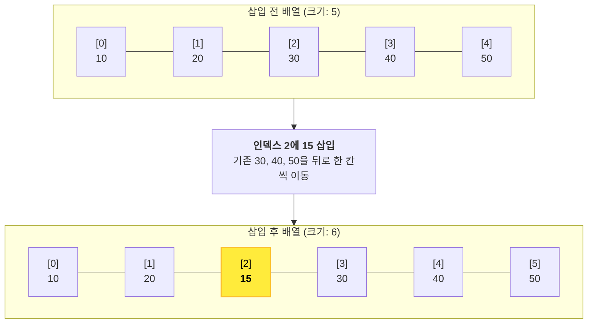

# Array(배열)

> 컴퓨터 과학에서 배열은 번호와 번호에 대응하는 데이터들로 이루어진 자료 구조를 나타낸다.


**Array(배열) == Sequential List(순차 리스트)**, 연속적인 메모리 위치의 집합이라고 정의되어짐

<div style="text-align: center;">


</div>


> 배열은 고정된 크기의 연속된 메모리 공간에 저장되는 데이터 구조로, 인덱스를 통해 요소에 접근

**배열(Array)은 동일한 자료형의 데이터를 연속된 메모리 공간에 저장하고, 인덱스(Index)를 통해 각 요소에 접근하는 자료구조**

```cpp
int arr[5] = {10, 20, 30, 40, 50};
```

| 인덱스 | 값 | 메모리 주소 예시 |
| :---: | :---: | :---: |
| 0 | 10 | 1000 |
| 1 | 20 | 1004 |
| 2 | 30 | 1008 |
| 3 | 40 | 1012 |
| 4 | 50 | 1016 |

$$
Address(arr[i]) = BaseAddress + i \times sizeof(T)
$$

- BaseAddress: 배열의 시작 주소
- `i`: 접근할 인덱스
- `sizeof(T)`: 요소 하나의 크기

---

## 특징

- **연속된 메모리**
  배열은 연속된 메모리 공간에 저장되므로 메모리 접근 속도를 빠르게 직접 접근 가능

- **인덱스 기반 접근**
  배열의 요소는 인덱스를 통해 `O(1)` 시간 복잡도로 접근

- **고정 크기**
  배열은 선언 시 크기가 고정되며, 이후 크기를 변경 X

- **장점**

  - 탐색에 유리: 인덱스 기반 접근 덕분에 데이터를 빠르게 조회 가능
    메모리가 연속적이라 접근 시간이 일정하고 효율적

  - CPU가 데이터를 순차적으로 읽을 때 캐시 지역성(Cache Locality)을 활용하기 좋다는 장점

- **단점**

  - 크기가 고정

  - 동적으로 크기를 변경하는 것이 어려움

  - 요소의 추가 및 삭제가 비효율적(추가/삭제할 때마다 배열을 재구성해야 할 수 있음)

## 배열의 활용

- **data 저장 및 관리**

  List, table, graph 등의 data를 저장하고 관리할 때 사용


- **알고리즘 구현**

  정렬, 탐색, 그래프 등 다양한 알고리즘을 구현할 때 활용


- **다차원 배열**

  행렬, 이미지, 다차원 데이터 등을 표현할 때 사용


- **컬렉션 관리**

  많은 요소를 한 번에 관리하거나 순회할 때 사용

## CRUD

- **Create/Init(생성)**

  ```cpp
  std::vector<int> arr = {10, 20, 30, 40, 50};
  ```

  ```
  10 20 15 30 40 50 60
  ```

  ```cpp
  // 마지막에 요소 추가
  arr.push_back(60);

  // 특정 위치에 요소 삽입
  arr.insert(arr.begin() + 2, 15);
  ```

  - `push_back()`: 마지막에 요소 추가

  - `insert()`: 지정한 위치에 요소 삽입

  ---


- **Read(읽기)**

  ```cpp
  // 인덱스를 통한 접근
  std::cout << arr[2] << '\n';

  // 배열 전체 순회
  for (int i = 0; i < arr.size(); ++i) {
      std::cout << "index: " << i
              << ", value: " << arr[i] << '\n';
  }

  // 범위 기반 for문
  for (int value : arr) {
      std::cout << value << '\n';
  }
  ```


  인덱스를 알고 있다면 직접 접근할 수 있고, 전체 요소를 순회 가능

  ```cpp
  // at
  std::cout << arr.at(2) << '\n'; // 30
  ```

  *cf.* `std::vector::operator[]` *는 기본적으로 인덱스 범위를 검사하지 않아. 범위 검사가 필요한 경우* `at()` *을 사용할 수 있음*

  ---

- **Update(수정)**

  - **append**(맨 뒤 추가)

    ```swift
    // swift
    arr.append(60)
    print(arr)
    // 배열 끝에 요소 추가(Append)
    //[38, 57, 50, 84, 28, 49, 80, 36, 82, 7, 7, 43, 12, 15, 38, 79, 60]
    ```

     <br/>

  - **insert**(특정 index 위치 추가)

    ```swift
    // swift
    arr.insert(5, at: 2)
    print(arr)
    // 배열의 특정 위치에 요소 삽입(인덱스 2에 5 Insert)
    // [38, 57, 5, 50, 84, 28, 49, 80, 36, 82, 7, 7, 43, 12, 15, 38, 79, 60]
    ```

    ---

  - **Update**(요소 인덱스로 접근하여 수정)
    ```cpp
    /// index 1의 값을 100으로 변경
    arr[1] = 100;
    ```

    기존 요소를 찾아서 교체하는 것이므로 인덱스를 알고 있다면 $O(1)$

    ---

- **Delete**(삭제)

  - `pop_back()`

    ```cpp
    // 마지막 요소 삭제
    arr.pop_back();
    ```

  - `erase()` : 지정한 위치 또는 범위 삭제

    ```cpp
    // index 2의 요소 삭제
    // #include <algorithm> 헤더 필요
    arr.erase(arr.begin() + 2);
    ```

  - `clear()` : 전체 요소 삭제

    ```cpp
    // 전체 요소 삭제
    arr.clear();
    ```

- *etc.* `find()`: 특정 값 검색

    ```cpp
    // 특정 값 검색 후 삭제
    auto it = std::find(arr.begin(), arr.end(), 40);

    if (it != arr.end()) {
      arr.erase(it); 
    }

    ```

    ---

## 배열의 시간 복잡도

*배열은 어떤 작업을 하느냐에 따라 성능이 달라진다.*


| 작업 | 시간 복잡도 | 이유 |
| :--- | :--- | :--- |
| 인덱스 접근 | `O(1)` | 주소 직접 계산 |
| 값 검색 |`O(n)` | 최악의 경우 전체 탐색 |
| 마지막 추가 | `O(1)` | 여유 공간이 있을 때 |
| 중간 삽입 | `O(n)`| 기존 요소 이동 |
| 마지막 삭제 | `O(1)` | 마지막 요소 제거 |
| 중간 삭제 | `O(n)` | 뒤쪽 요소 이동 |
| 전체 순회 | `O(n)` | 모든 요소 방문 |

### 왜 중간 삽입은 $O(n)$ 일까?



인덱스 2에 새로운 요소를 삽입하려면 기존 요소들이 뒤로 이동해야 함

데이터가 5개라면 최대 3개의 요소를 이동하고, 데이터가 1,000개라면 최대 999개를 이동할 수 있음

즉 데이터 개수에 비례해 작업량이 증가하므로 $O(n)$

---

## 배열과 C++ STL의 관계

1. C 스타일 배열 : 크기를 선언할 때 결정하는 기본 배열

    ```c
   int arr[5] = {1, 2, 3, 4, 5};
    ```

2. `std::array` **(고정 크기 STL)** : 고정 크기 배열을 STL 컨테이너의 형태로 제공

    ```cpp
    #include <array>

    std::array<int, 5> arr = {1, 2, 3, 4, 5};
    ```

3. `std::vector` **(동적 크기 STL)** : 실행 중 요소를 추가하거나 삭제할 수 있는 동적 배열

    ```cpp
    #include <vector>

    std::vector<int> arr = {1, 2, 3, 4, 5};
    arr.push_back(6);
    ```

    - `std::vector`도 배열 기반 자료구조

    - 내부적으로 연속된 메모리 공간을 사용하고, 필요할 때 더 큰 메모리 공간을 확보해 기존 요소를 옮기는 방식으로 용량을 관리

---

## `size()`와 `capacity()`의 차이

- `size()`: 현재 실제로 저장된 요소의 개수
- `capacity()`: 재할당 없이 저장할 수 있는 요소의 최대 개수

- `reserve()`: 용량 확보, size 변경 없음

- `resize()`: 요소 개수 변경, 필요한 경우 용량도 변경

---

## 바로 공부하기 좋은 알고리즘

- [BruteForce](https://github.com/BOLTB0X/DataStructure-Algorithm/tree/main/Algorithm/BruteForce)


## 참고

- [공식문서 - Array](https://developer.apple.com/documentation/swift/array)

- [위키백과 - 배열](https://ko.wikipedia.org/wiki/%EB%B0%B0%EC%97%B4)

- [블로그 참고 - web-km(배열)](https://web-km.tistory.com/52)

- [블로그 참고 - limecoding(배열)](https://limecoding.tistory.com/78)

- [이미지 생성 - visualgo](https://visualgo.net)
