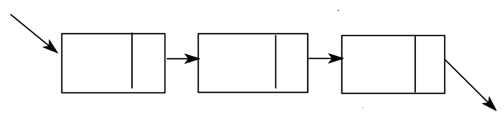
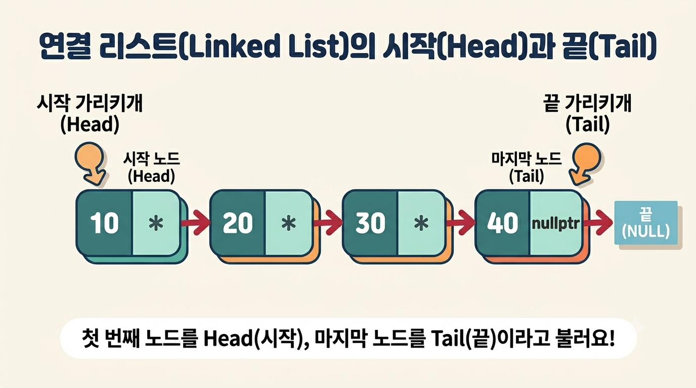
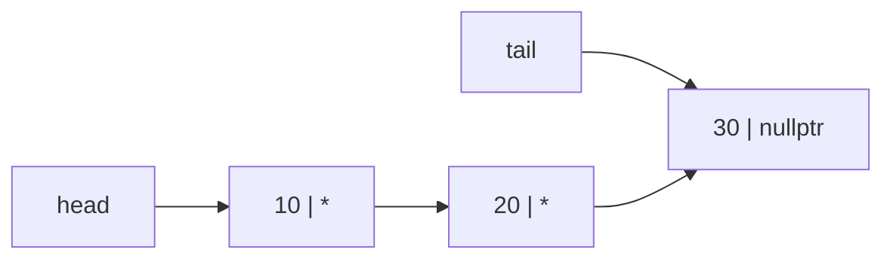
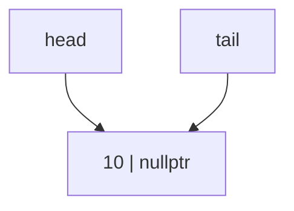
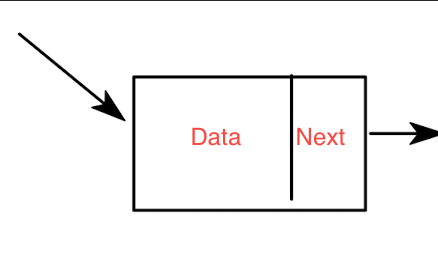
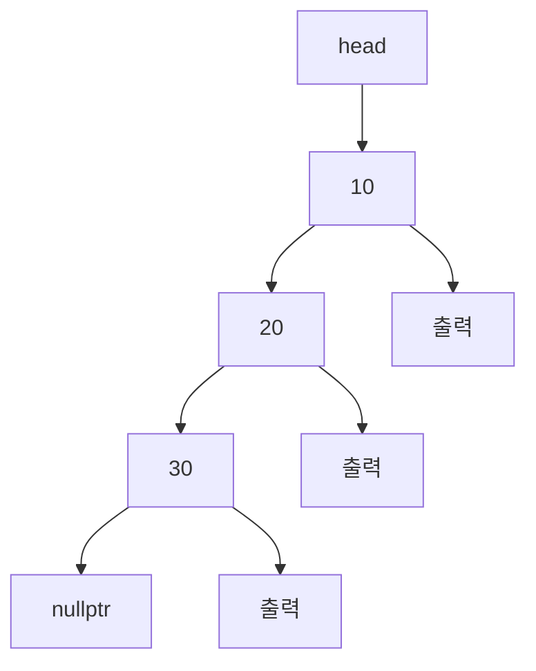

# Singly Linked List(단일 연결 리스트)

> 단일 연결 리스트는 각 노드가 다음 노드를 가리키는 방식으로 연결

<div style="text-align: center;">


data를 저장하는 **노드(Node)** 들이 한 줄로 연결된 자료구조

</div>

배열과 가장 큰 차이점은 메모리 저장 방식

- 배열: 연속된 메모리 공간에 데이터를 저장
- 연결 리스트: 각 노드가 메모리의 서로 다른 위치에 존재할 수 있으며, 포인터로 다음 노드를 연결


- **Node:** 데이터를 저장하는 단위

- **Data:** 실제 저장할 값

- **Pointer:** 다음 노드의 주소를 저장하는 변수

- **Head:** 연결 리스트의 첫 번째 노드를 가리키는 포인터


---

## 특징

- 노드가 data와 다음 노드를 가리키는 포인터 두가지를 가리키는 형태

- 연속되지 않은 메모리에 저장된 데이터들을 연결시켜 놓은 것

---

## Singly Linked 리스트의 메모리 구조

- **배열(Array):** 메모리 주소가 연속적으로 배치

  ```
  주소       데이터
  1000       [10]
  1004       [20]
  1008       [30]
  1012       [40]
  ```

- **Linked List:** 메모리상으로는 떨어져 있어도 포인터를 통해 논리적으로 연결

  ```cpp
  주소       데이터       다음 노드 주소
  1000       [10]         2040
  2040       [20]         1500
  1500       [30]         3080
  3080       [40]         nullptr
  ```

  물리적인 메모리 위치와 논리적인 데이터 순서는 다를 수 있다는 것

## 연결 리스트의 CRUD

### Head & Tail

<div style="text-align: center;">

</div>

- **head:**	첫 번째 노드를 가리킴
- **tail:**	마지막 노드를 가리킴



- `head` 를 이용하면 첫 번째 노드에 바로 접근 가능
- `tail`을 이용하면 마지막 노드에 바로 접근 가능
- 마지막 노드의 `next`는 항상 `nullptr`

**연결 리스트가 비어 있다면 `head` 와 `tail` 은 모두 `nullptr`이어야 함**

**반대로 노드가 하나만 존재한다면 두 포인터 모두 같은 노드를 가리켜야 함**



---

### Node

<div style="text-align: center;">


현재 위치 data와 다음 위치 data의 주소값을 가짐

</div>

```cpp
struct Node
{
    int data;
    Node* next;

    Node(int value)
        : data(value), next(nullptr)
    {
    }
};
```

- `data`: 실제 데이터

- `next`: 다음 노드의 주소

- `Node(int value)`: 노드를 생성할 때 데이터 초기화

---

### Create (생성 및 삽입)

1. **맨 뒤에 추가 (`PushBack`):** tail`을 사용하면 마지막 노드를 탐색하지 않고 바로 접근할 수 있음

  ```cpp
  void PushBack(int value)
  {
      Node* newNode = new Node(value);

      // 연결 리스트가 비어 있는 경우
      if (head == nullptr)
      {
          head = newNode;
          tail = newNode;
          return;
      }

      // 기존 마지막 노드와 새로운 노드 연결
      tail->next = newNode;

      // tail 갱신
      tail = newNode;
  }
  ```

  ```mermaid
  flowchart TD
    subgraph Before["삽입 전 (tail이 30을 가리킴)"]
        direction LR
        B_H["head"] --> B_10["10"]
        B_10 --> B_20["20"]
        B_20 --> B_30["30"]
        B_T["tail"] --> B_30
    end

    subgraph After["40 추가 후 (tail이 40을 가리킴)"]
        direction LR
        A_H["head"] --> A_10["10"]
        A_10 --> A_20["20"]
        A_20 --> A_30["30"]
        A_30 --> A_40["40"]
        A_T["tail"] --> A_40
    end

    Before -.->|"40 추가"| After
  ```

  시간 복잡도는 $O(1)$

2. **맨 앞에 추가 (`PushFront`):** 기존 리스트가 비어 있지 않다면 새로운 노드가 첫 번째 노드가 되고, 기존 노드들은 그대로 유지

  ```cpp
  void PushFront(int value)
  {
      Node* newNode = new Node(value);

      // 새로운 노드가 기존 head를 가리킴
      newNode->next = head;

      // head 갱신
      head = newNode;

      // 기존 리스트가 비어 있었다면 tail도 갱신
      if (tail == nullptr)
      {
          tail = newNode;
      }
  }
  ```

    시간 복잡도는 $O(1)$

3. **특정 노드 뒤에 추가 (`InsertAfter`):** 특정 노드를 이미 알고 있다면 그 뒤에 새로운 노드를 삽입 가능

  ```cpp
  void InsertAfter(Node* target, int value)
  {
      if (target == nullptr) return;

      Node* newNode = new Node(value);

      newNode->next = target->next;
      target->next = newNode;

      // 마지막 노드 뒤에 삽입했다면 tail 갱신
      if (tail == target) { 
        tail = newNode;
      }
  }
  ```

  ex) 20 뒤에 25를 추가한다면

  ```
  [10] -> [20] -> [25] -> [30]
                 ^
                 |
               newNode
  ```

  이미 `target`을 알고 있다는 전제에서 $O(1)$

---

## Read (읽기)

연결 리스트는 배열과 달리 인덱스를 이용한 직접 접근이 불가능하므로 head부터 순서대로 탐색해야 함

```cpp
void Print() {
    Node* current = head;

    while (current != nullptr)
    {
        std::cout << current->data << " ";

        current = current->next;
    }

    std::cout << '\n';
}
```



시간 복잡도는 $O(n)$

### 특정 값 검색 (Find)

```cpp
Node* Find(int value) {
    Node* current = head;

    while (current != nullptr) {
        if (current->data == value) {
            return current;
        }

        current = current->next;
    }

    return nullptr;
}
```

찾고 싶은 값이 존재하면 해당 노드의 주소를 반환하고, 없다면 `nullptr`를 반환

시간 복잡도는 $O(n)$

---

## Update (수정)

특정 노드를 검색하고 데이터를 수정 가능

```cpp
bool Update(int oldValue, int newValue)
{
    Node* target = Find(oldValue);

    if (target == nullptr)
        return false;

    target->data = newValue;

    return true;
}
```

만약 20을 200으로 수정하면

```
[10] -> [200] -> [30]
```

검색 과정 때문에 전체 시간 복잡도는 $O(n)$

단, 이미 노드 주소를 알고 있다면 데이터 수정 자체는 $O(1)$

---

## Delete (삭제)

삭제는 `head`와 `tail` 을 함께 관리할 때 주의할 부분이 있음

1. **맨 앞 노드 삭제 (`PopFront`)**

  ```cpp
  void PopFront() {
      if (head == nullptr) return;

      Node* target = head;
      head = head->next;

      delete target;

      // 마지막 노드를 삭제한 경우
      if (head == nullptr)
      {
          tail = nullptr;
      }
  }
  ```

  - 기존 첫 번째 노드를 삭제하고 `head`를 다음 노드로 이동

  - 만약 노드가 하나뿐이었다면 `head`가 `nullptr`가 되므로 `tail`도 `nullptr`로 변경

  - 시간 복잡도는 $O(1)$

2. **맨 뒤 노드 삭제 (`PopBack`)**

  ```cpp
  void PopBack() {
      if (head == nullptr) return;

      // 노드가 하나뿐인 경우
      if (head == tail) {
          delete head;

          head = nullptr;
          tail = nullptr;

          return;
      }

      Node* current = head;

      // 마지막 노드의 이전 노드 탐색
      while (current->next != tail)
      {
          current = current->next;
      }

      delete tail;

      tail = current;
      tail->next = nullptr;
  }
  ```

  - 단일 연결 리스트는 `tail`을 가지고 있더라도 이전 노드로 이동할 수 없음
  - 마지막 노드를 삭제하려면 `head`부터 순회해서 마지막 노드의 이전 노드를 찾아야 함
  - 시간 복잡도는 $O(n)$

3. **특정 값 삭제 (`Remove`)**

```cpp
bool Remove(int value)
{
    if (head == nullptr)
        return false;

    // 첫 번째 노드를 삭제하는 경우
    if (head->data == value)
    {
        PopFront();
        return true;
    }

    Node* current = head;

    // 삭제할 노드의 이전 노드 탐색
    while (current->next != nullptr)
    {
        if (current->next->data == value)
        {
            Node* target = current->next;

            current->next = target->next;

            // 마지막 노드를 삭제한 경우 tail 갱신
            if (target == tail)
            {
                tail = current;
            }

            delete target;

            return true;
        }

        current = current->next;
    }

    return false;
}
```

  - 시간 복잡도는 $O(n)$

4. **전체 삭제 (`Clear`)**

  ```cpp
  void Clear() {
      while (head != nullptr)
      {
          Node* target = head;
          head = head->next;
          delete target;
      }

      tail = nullptr;
  }
  ```

  - 모든 노드를 삭제하고 마지막에 `tail`도 초기화

  - 시간 복잡도는 $O(n)$

## 참고

- [블로그 참조 - 개발자소들이(단일연결리스트)](https://babbab2.tistory.com/86)

- [블로그 참조 - newon(단일연결리스트)](https://velog.io/@newon-seoul/Swift%EC%9E%90%EB%A3%8C%EA%B5%AC%EC%A1%B0-LinkedList-1%ED%8E%B8-Node-%EC%99%80-LinkedList-%EC%97%90-%EC%B6%94%EA%B0%80%ED%95%98%EA%B8%B0)

- [블로그 참조 - leonfather(단일연결리스트)](https://leonfather.tistory.com/38)

- [블로그 참조 - chanos(단일연결리스트)](https://chanos.tistory.com/entry/%EC%9E%90%EB%A3%8C%EA%B5%AC%EC%A1%B0-%EB%8B%A8%EB%B0%A9%ED%96%A5-%EC%97%B0%EA%B2%B0%EB%A6%AC%EC%8A%A4%ED%8A%B8Singly-Linked-List%EB%9E%80-%EA%B5%AC%ED%98%84%ED%95%98%EA%B8%B0)
